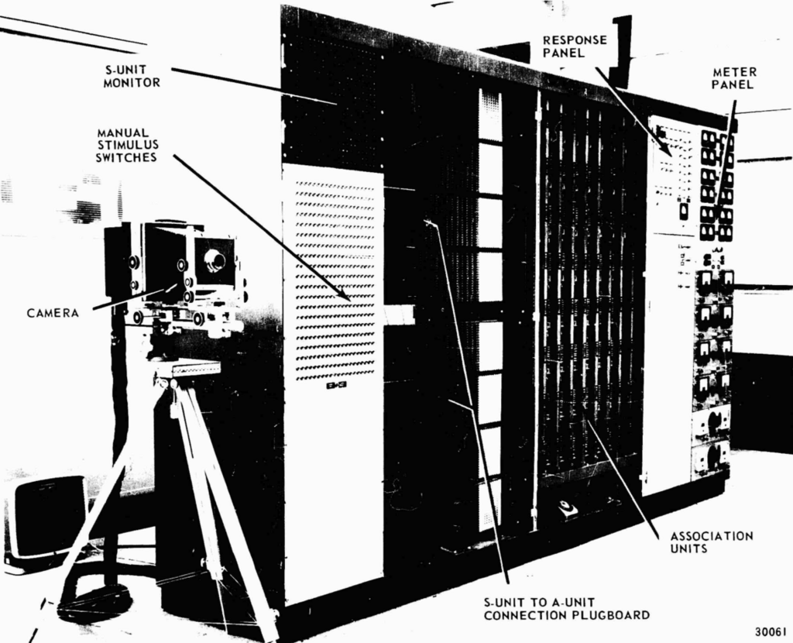
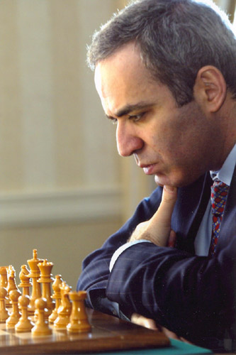
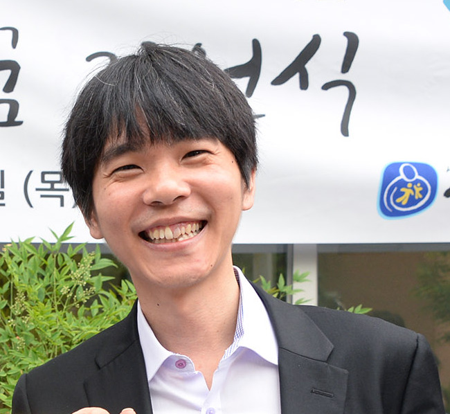

## Des pionniers au prix Nobel : l'histoire de l'Intelligence Artificielle

L'intelligence artificielle n'est pas un phénomène né en 2022 avec l'irruption de ChatGPT. Si l'IA fait aujourd'hui la une, son histoire est bien plus longue et remonte aux débuts de l'informatique, impliquant certains de ses plus grands noms.

La vidéo suivante, publiée par la Direction Régionale Académique du Numérique Éducatif de la région Grand-Est, retrace les grandes étapes de cette aventure humaine et technologique.

<iframe title="Histoire de l'intelligence artificielle" width="100%" height="100%" src="https://tube-numerique-educatif.apps.education.fr/videos/embed/pcgvWspA1PwiJiZX3Wqxyi" style="border: 0px; position: absolute; inset: 0px;" allow="fullscreen" sandbox="allow-same-origin allow-scripts allow-popups allow-forms"></iframe>

### Bref résumé de l'histoire de l'IA

L'histoire de l'IA est généralement divisée en quatre périodes. Voici un aperçu des étapes clés que vous découvrirez dans ce document :

#### 1. L'Ère des Pionniers et la Définition Fondamentale

L'histoire des prémisses de l'IA commence dès **1936**, lorsque **Alan Turing** propose un modèle de machine (la machine de Turing) capable de simuler le fonctionnement de n'importe quel algorithme, machine qui est devenue notre ordinateur actuel.

Pendant la Seconde Guerre mondiale, alors qu'Alan Turing travaillait à décrypter les messages nazis chiffrés par la machine Enigma, un article fondamental a été publié en **1943** par Warren McCulloch et Walter Pitts. Ils y proposaient le premier **modèle de neurone mathématique**, inspiré du neurone biologique. L'intention était claire : s'inspirer du vivant pour créer une machine potentiellement plus puissante que la machine de Turing grâce à un réseau bouclé de neurones artificiels.

Ce n'est qu'en **1956** que le terme "Intelligence Artificielle" est forgé lors de la conférence de Dartmouth dans le New Hampshire, réunissant une vingtaine de spécialistes. L'IA y est définie comme un système capable de résoudre des problèmes **normalement réservés à l'intelligence humaine**.

#### 2. Les Premières Machines et les Hivers Technologiques

Le passage de la théorie à la pratique survient en **1957** avec Frank Rosenblatt, qui propose le premier modèle de machine capable d'apprendre, fondé sur un réseau de neurones artificiels. Cela a mené au **Mark 1 Perceptron**, une machine composée de 400 cellules photoélectriques et d'une seule couche de neurones, capable de tâches simples comme la reconnaissance de caractères. Cependant, le Perceptron, limité en puissance de calcul et incapable de traiter des problèmes non linéaires (comme distinguer précisément les spams des non-spams), a rapidement atteint ses limites.

{width='66%'}

Ces difficultés techniques ont conduit au **premier hiver de l'intelligence artificielle** à partir de **1974**, une période de désintérêt et de blocage.

La reprise a nécessité une rupture technologique, qui est survenue en **1986** avec la réappropriation de l'algorithme de **rétropropagation du gradient**. Cet algorithme permet d'optimiser l'apprentissage des neurones artificiels en calculant l'erreur en sortie et en la faisant remonter pour modifier les connexions.

Malgré cela, un **deuxième hiver** a eu lieu en **1987**, principalement lié à un manque d'investissement. Les investisseurs ne voyaient pas le potentiel de la technologie. Il manquait alors une promesse ou un « storytelling » pour séduire l'opinion publique.

#### 3. La Consécration et l'Ère du Deep Learning

Pour attirer les investisseurs, il a fallu des événements médiatiques marquants :

*   **1997 : La force brute**. L'ordinateur **Deep Blue** d'IBM, un monstre de 2 tonnes capable de calculer 100 millions de coups à la seconde, bat le champion du monde d'échecs, Garry Kasparov, en six manches. Deep Blue utilisait l'algorithme Minimax pour trier les possibilités et maximiser ses profits.
  

*   **2012 : La Naissance du Deep Learning**. Lors du concours ImageNet, l'informaticien Alex Krizhevsky remporte la victoire en réduisant de moitié le taux d'erreur de ses concurrents. Ses deux idées révolutionnaires furent d'utiliser des **processeurs graphiques (GPU)**, beaucoup plus puissants que les CPU, et de monter son réseau de neurones en **couches successives**. Chaque couche décompose l'information en éléments élémentaires. C'est la naissance de l'**apprentissage profond** (deep learning).
*   **2016 : L'intelligence stratégique**. L'ordinateur **AlphaGo** de Google bat le champion du monde de jeu de go, Lee Sedol. Le jeu de go est bien plus complexe que les échecs (300 à 400 coups possibles contre 20 à 30 en moyenne). Cette victoire prouve que l'IA a non seulement gagné en puissance de calcul, mais qu'elle est également capable de faire preuve d'une **intelligence stratégique**. Le fameux **37e coup** de la seconde partie, totalement inattendu, est souvent cité comme l'exemple d'une nouvelle stratégie qui a déstabilisé l'adversaire et les commentateurs.

{width='33%'}

Depuis 2016, c'est l'époque de la consécration et de la découverte par le grand public. Les progrès dans le traitement du langage naturel (comme l'assistant vocal **Siri** d'Apple lancé en **2011**) ont également amélioré l'interaction homme-machine.

La reconnaissance scientifique s'est manifestée par l'attribution du prix Turing à Yann Le Cun, Geoffrey Hinton et Joshua Bengio pour leurs travaux sur le *deep learning*. Plus récemment, en 2024, le **prix Nobel de physique** a été attribué à Geoffrey Hinton et John Hopfield.

