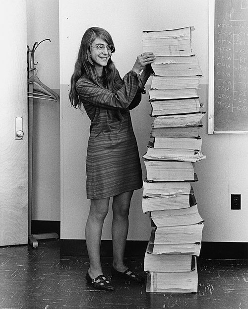

Margaret Hamilton est décédée le 30 septembre 2026, à l'âge de 90 ans. Le MIT a annoncé la nouvelle le 7 octobre. Dans le grand public, elle reste associée à une photographie célèbre : une jeune femme souriante posant à côté d'une pile de listings aussi haute qu'elle. Cette pile, c'est le code du logiciel de vol des missions Apollo, développé par l'équipe qu'elle dirigeait.

Derrière l'image, il y a une carrière qui a marqué durablement la manière de concevoir des logiciels fiables. Cet article revient sur son parcours et sur ce qu'elle a apporté à notre discipline.



## Du Midwest au MIT

Margaret Hamilton naît en 1936 à Paoli, dans l'Indiana. Elle commence des études de mathématiques à l'université du Michigan en 1955, puis les poursuit à l'Earlham College, où elle obtient en 1958 une licence de mathématiques avec une mineure en philosophie.

En 1959, elle s'installe à Boston avec son mari, qui prépare un diplôme de droit. Elle trouve un poste temporaire au département de météorologie du MIT, auprès du professeur Edward Lorenz, pour travailler sur un logiciel de prévision météo. C'est sa première rencontre avec la programmation, et ses travaux alimenteront plus tard les publications de Lorenz sur la théorie du chaos.

En 1961, elle rejoint le laboratoire Lincoln du MIT et participe au projet SAGE, le premier système de défense aérienne des États-Unis : elle y écrit des programmes pour un prototype d'ordinateur chargé de détecter des avions potentiellement hostiles. C'est là qu'elle commence à s'intéresser à la **fiabilité des logiciels**, une question encore très peu explorée à l'époque.

## Apollo : un logiciel qui ne peut pas se tromper

En 1965, alors qu'elle envisage de reprendre des études, une annonce de journal attire l'attention de son mari : l'Instrumentation Lab du MIT recrute pour développer le logiciel qui doit « envoyer l'homme sur la Lune ». Le laboratoire a remporté le contrat de la NASA pour le logiciel de vol embarqué du programme Apollo. Margaret Hamilton postule et devient la première programmeuse du projet côté MIT.

Elle travaille d'abord sur les missions non habitées, puis prend la direction de l'équipe chargée du logiciel des missions habitées. En 1968, elle est directrice adjointe en charge de l'équipe du module de commande et de service, et plus de 400 personnes travaillent sur le logiciel d'Apollo.

Ce logiciel s'exécute sur l'*Apollo Guidance Computer* (AGC), l'ordinateur de navigation embarqué, parmi les premiers à utiliser des circuits intégrés. Ses ressources sont extrêmement limitées, et le droit à l'erreur est nul. Hamilton le résumera ainsi : il n'y avait pas de seconde chance [(MIT News, 2009)](https://news.mit.edu/2026/margaret-hamilton-computing-pioneer-dies-1007){target="_blank"}.

### « L'erreur de Lauren » et Apollo 8

Margaret Hamilton emmenait parfois sa fille Lauren, alors âgée de quatre ans, au laboratoire. Un jour, en jouant avec le simulateur du module de commande, l'enfant lance par erreur le programme P01 (préparation du lancement) alors que le simulateur est « en vol », ce qui fait planter l'ensemble.

Hamilton propose alors une protection logicielle pour empêcher cette erreur lors d'une vraie mission. Elle est refusée : des astronautes aussi entraînés ne feraient jamais une telle faute. Elle se contente donc d'ajouter un avertissement dans la documentation. Pourtant, lors de la mission Apollo 8, en 1968, Jim Lovell lance accidentellement P01 en plein vol et les données de navigation disparaissent. L'équipe de Hamilton intervient pour résoudre le problème, et la modification qu'elle avait proposée est ensuite intégrée au programme.

::: {.callout-tip}
## La programmation défensive

La **programmation défensive** consiste à écrire un programme en anticipant les erreurs, les dysfonctionnements et les usages imprévus, afin qu'il continue à fonctionner correctement malgré une anomalie. L'épisode de l'erreur de Lauren en est un exemple fondateur.

Voici une petite illustration (ce n'est évidemment pas le code d'Apollo) :

```python
def lancer_programme(nom, phase_en_cours):
    """Refuse d'exécuter un programme incompatible avec la phase de vol."""
    if nom == "P01" and phase_en_cours != "avant_lancement":
        print("Programme refusé : P01 ne peut pas être lancé en vol.")
        return False
    print(f"Programme {nom} lancé.")
    return True

lancer_programme("P01", "en_vol")  # refusé, les données sont préservées
```

Plutôt que de supposer que l'utilisateur ne se trompera jamais, on vérifie les conditions d'utilisation et on protège l'état du système.
:::

## Apollo 11 : l'alarme 1202

Le 20 juillet 1969, quelques instants avant l'alunissage du module Eagle, l'ordinateur de bord signale une alarme 1202 : il est en situation de surcharge, en raison d'un composant matériel défectueux, et on peut craindre qu'il ne parvienne plus à gérer la procédure d'atterrissage.

C'est ici que le travail de Hamilton et de son équipe se révèle décisif. Le logiciel était conçu autour d'un **système de priorités** : en cas de surcharge, il interrompt les tâches secondaires pour libérer les ressources nécessaires aux tâches critiques. Le centre de contrôle de Houston a fait confiance au logiciel, la mission a pu se poursuivre, et deux hommes ont marché pour la première fois sur la Lune.

::: {.callout-tip}
## Un lien avec le programme de NSI

Ce principe est celui de l'**ordonnancement avec priorités**, que l'on retrouve dans le programme de NSI : un ordonnanceur choisit toujours la tâche la plus prioritaire, et une tâche peut être suspendue au profit d'une autre. Les files de priorité étudiées en Terminale (chapitre sur les processus) en sont la version simplifiée.
:::

## Entrepreneuse et théoricienne du génie logiciel

Après Apollo, le laboratoire de l'Instrumentation Lab devient le laboratoire Draper, indépendant du MIT. Margaret Hamilton y travaille jusqu'au milieu des années 1970, puis fonde en 1976 sa première entreprise, *Higher Order Software*, centrée sur la prévention des erreurs et la tolérance aux pannes. Dix ans plus tard, elle crée *Hamilton Technologies*, dont le produit phare est l'*Universal Systems Language* (USL), un langage et une méthodologie de modélisation pour concevoir des systèmes complexes en privilégiant la prévention des erreurs.

Elle a aussi mené un combat de longue date pour faire reconnaître le logiciel comme une discipline d'ingénierie à part entière. Elle a expliqué avoir employé l'expression « génie logiciel » (*software engineering*) pour le distinguer du matériel, tout en le considérant comme une composante de l'ingénierie des systèmes. L'expression prêtait d'abord à sourire, avant que le logiciel ne gagne le respect accordé aux autres disciplines. Elle est l'une des personnes qui ont le plus contribué à populariser le terme et le concept. Elle est l'autrice de plus de 130 publications.

## Une reconnaissance tardive

Pendant longtemps, le travail de Margaret Hamilton est resté peu connu. Les premières distinctions importantes arrivent au début des années 2000 :

* 2003 : *NASA Exceptional Space Act Award* ;
* 2016 : Médaille présidentielle de la liberté, remise par Barack Obama ;
* 2017 : *Computer History Museum Fellow Award* ;
* 2019 : *Intrepid Lifetime Achievement Award* ;
* 2022 : intronisation au *National Aviation Hall of Fame*.

La diffusion de la photographie des listings, puis la publication en 2015 de l'intégralité du code source d'Apollo sur GitHub, ont élargi sa notoriété. Elle est devenue une figure emblématique de la place des femmes dans les sciences et les technologies, jusqu'à devenir en 2017 une figurine Lego, dans un ensemble consacré à des femmes de l'histoire de la NASA.

## Ce qu'elle nous laisse

L'héritage de Margaret Hamilton tient en quelques idées simples, mais toujours d'actualité :

* **Anticiper l'erreur** plutôt que supposer qu'elle ne se produira pas ;
* **Hiérarchiser les tâches** pour que le système reste utilisable en situation de surcharge ;
* **Considérer le logiciel comme une ingénierie**, avec ses méthodes, ses tests et sa rigueur.

**Sources utilisées pour cet article :**

- [Margaret Hamilton, computing pioneer, dies at 90](https://news.mit.edu/2026/margaret-hamilton-computing-pioneer-dies-1007){target="_blank"} (MIT News, 07/10/2026)
- [Margaret Hamilton, génie de l'ingénierie logicielle, est morte à 90 ans](https://next.ink/brief-article/margaret-hamilton-genie-de-lingenierie-logicielle-est-morte-a-90-ans/){target="_blank"} (Next, octobre 2026)
- [Margaret Hamilton (1936-2026)](https://linuxfr.org/news/margaret-hamilton-1936-2026){target="_blank"} (LinuxFr.org)
