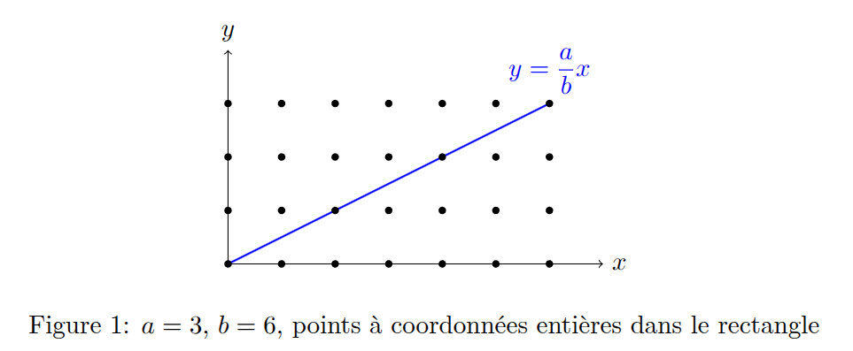
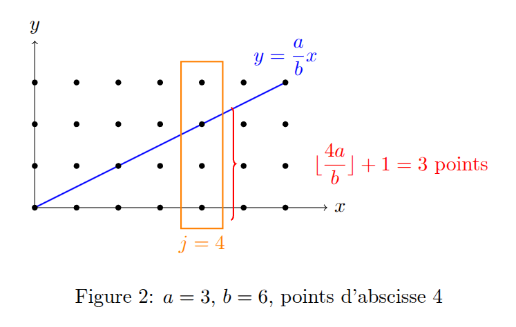

Un ami m'a récemment fait découvrir une formule étonnante : il s'agit d'une formule explicite pour calculer le PGCD (Plus Grand Commun Diviseur) de deux nombres entiers $a$ et $b$. La formule est la suivante, pour tous $(a,b) \in \mathbb{N}^2$ :

$$\boxed{pgcd(a,b) = a + b - ab + 2 \sum _{j=1}^{b-1} \left\lfloor \frac{aj}{b} \right\rfloor}$$

où $\lfloor x \rfloor$ désigne la partie entière de $x$.

Cette formule est inhabituelle, car on a l'habitude de calculer le PGCD plutôt à l'aide d'un processus itératif, comme l'algorithme d'Euclide ou à l'aide de la décomposition en facteurs premiers.

Je vais en donner une démonstration très visuelle et amusante.

Considérons, dans un repère orthonormé $(O, \vec{i}, \vec{j})$ du plan, la droite d'équation $y = \dfrac{a}{b}x$ et les points du plan de coordonnées entières situés dans le rectangle $[0,b] \times [0,a]$.

Il est clair que ce rectangle contient exactement $(a+1)(b+1)$ points à coordonnées entières et que ceux-ci sont répartis de façon symétrique de part et d'autre de la droite $y = \dfrac{a}{b}x$.

Notons $N$ le nombre de points à coordonnées entières situés dans le rectangle (au sens large), on a alors :

$$N = (a+1)(b+1) = ab + a + b + 1$$

Exploitons maintenant la symétrie de la figure pour obtenir une autre expression de $N$. Pour cela, nous allons dénombrer les points à coordonnées entières situés au-dessous (au sens large) de la droite $y = \dfrac{a}{b}x$ (c'est-à-dire les points $(x,y)$ à coordonnées entières tels que $y \leqslant \dfrac{a}{b}x$).

Par définition de la partie entière d'un réel, nous savons que, pour tout $y\in\mathbb{R}$, $y\geqslant 0$, on a :

$$0 \leqslant \lfloor y \rfloor \leqslant y < \lfloor y \rfloor + 1$$

On en déduit que, pour tout entier $j$ tel que $0 \leqslant j \leqslant b$, le nombre de points d'abscisse $j$ situés au-dessous de la droite $y = \dfrac{a}{b}x$, au sens large, est égal à $\left\lfloor \dfrac{aj}{b} \right\rfloor + 1$ : on ajoute 1 pour tenir compte du point d'abscisse $j$ situé sur l'axe des abscisses.

En sommant sur tous les entiers $j$ tels que $0 \leqslant j \leqslant b$, on trouve que le nombre de points à coordonnées entières situés au-dessous de la droite $y = \dfrac{a}{b}x$ (au sens large) est égal à :

$$\sum _{j=0}^{b} \left( \left\lfloor \frac{aj}{b} \right\rfloor + 1 \right) = (b+1) + \sum _{j=0}^{b} \left\lfloor \frac{aj}{b} \right\rfloor$$

Remarquons que lorsque $j=0$, on a $\left\lfloor \frac{aj}{b} \right\rfloor = 0$, et que lorsque $j=b$, on a $\left\lfloor \frac{aj}{b} \right\rfloor = a$. La somme précédente peut donc être réécrite de la manière suivante :

$$
(b+1) + \sum _{j=0}^{b} \left\lfloor \frac{aj}{b} \right\rfloor = (b+1) + a + \sum _{j=1}^{b-1} \left\lfloor \frac{aj}{b} \right\rfloor
$$

En utilisant la symétrie de la figure, on en déduit que le nombre $N$ de points à coordonnées entières dans le rectangle est égal à deux fois le nombre de points situés au-dessous de la droite $y = \dfrac{a}{b}x$ (au sens large), en prenant garde à **ne pas compter deux fois les points situés sur la droite $y = \dfrac{a}{b}x$**. Notons provisoirement $\delta$ le nombre de points à coordonnées entières situés sur la droite $y = \dfrac{a}{b}x$, on a alors :

$$N = 2 \left( (b+1) + a + \sum _{j=1}^{b-1} \left\lfloor \frac{aj}{b} \right\rfloor \right) - \delta$$

Il ne reste plus qu'à calculer $\delta$. Un point à coordonnées entières de la forme $(x,y)$ est situé sur la droite $y = \dfrac{a}{b}x$ si et seulement si $y = \dfrac{ax}{b}$, c'est-à-dire si et seulement si $b \mid ax$.

Soit $d=pgcd(a,b)$, il existe alors des entiers $a'$ et $b'$ tels que $a = da'$ et $b = db'$, avec $pgcd(a',b')=1$. La condition $b \mid ax$ est alors équivalente à la condition $db' \mid da'x$, c'est-à-dire à la condition $b' \mid a'x$. Étant donné que $pgcd(a',b')=1$, cela équivaut à la condition $b' \mid x$ d'après le théorème de Gauss.

On a donc $x=kb'$, avec $0 \leqslant x \leqslant b$, ce qui équivaut à $0 \leqslant k \leqslant d$ : on en déduit que $k$ peut prendre toutes les valeurs entières de $0$ à $d$. Il y a donc exactement $d+1$ points à coordonnées entières situés sur la droite $y = \dfrac{a}{b}x$, ce qui signifie que $\delta = d + 1 = pgcd(a,b) + 1$.

En reportant cette valeur de $\delta$ dans l'expression de $N$, on trouve que :

$$N = 2 \left( (b+1) + a + \sum _{j=1}^{b-1} \left\lfloor \frac{aj}{b} \right\rfloor \right) - (pgcd(a,b) + 1)$$

En égalant les deux expressions de $N$, on trouve que :

$$
(a+1)(b+1) = 2 \left( (b+1) + a + \sum _{j=1}^{b-1} \left\lfloor \frac{aj}{b} \right\rfloor \right) - (pgcd(a,b) + 1)
$$

Développons ce qui peut l'être dans l'expression précédente :

$$ab + a + b + 1 = 2b + 2 + 2a + 2 \sum _{j=1}^{b-1} \left\lfloor \frac{aj}{b} \right\rfloor - pgcd(a,b) - 1$$

En réarrangeant les ter
mes, on trouve que :

$$\boxed{pgcd(a,b) = a + b - ab + 2 \sum _{j=1}^{b-1} \left\lfloor \frac{aj}{b} \right\rfloor}$$

Appliquons cette formule pour calculer le PGCD de $a=3$ et $b=6$. On trouve que :

$$
\begin{aligned}
pgcd(3,6) &= 3 + 6 - 3 \times 6 + 2 \sum _{j=1}^{5} \left\lfloor \frac{3j}{6} \right\rfloor \\
&= 9 - 18 + 2 \left( \left\lfloor \frac{3}{6} \right\rfloor + \left\lfloor \frac{6}{6} \right\rfloor + \left\lfloor \frac{9}{6} \right\rfloor + \left\lfloor \frac{12}{6} \right\rfloor + \left\lfloor \frac{15}{6} \right\rfloor \right) \\
&= -9 + 2 \left( 0 + 1 + 1 + 2 + 2 \right) \\
&= -9 + 2 \times 6 \\
&= -9 + 12 \\
&= 3
\end{aligned}
$$

Ce qui est bien égal au PGCD de $3$ et $6$.

