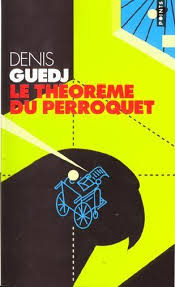

Quand j'introduis les nombres complexes en Terminale, je commence par une histoire : celle de la formule de résolution des équations du troisième degré, de la rivalité entre Tartaglia et Cardan, puis de l'apparition, dans cette formule, de racines carrées de nombres négatifs. La version que l'on trouve dans de nombreux ouvrages de vulgarisation est simple : Cardan aurait **trompé** Tartaglia pour lui arracher son secret, avant de le publier sous son propre nom.

Un article d'Antoine  HOULOU-GARCIA lu récemment dans *Tangente* ([N°231 · 8 septembre 2026](https://tangente-mag.com/magazines/l-infini-existe-t-il-vraiment)) présente au contraire Cardan sous un jour beaucoup plus favorable. Qui a raison ? Cet article tente de faire le point à partir de sources historiques accessibles.

## L'histoire telle qu'on la raconte

La version courante tient en quelques lignes :

1. Tartaglia découvre la formule de résolution de certaines équations du troisième degré et la garde secrète.
2. Cardan le fait venir à Milan et lui arrache le secret en jurant de ne jamais le divulguer.
3. Quelques années plus tard, Cardan publie la formule dans son *Ars Magna* (1545), en violation de son serment.
4. Tartaglia, furieux, est dépossédé de sa découverte, qui porte aujourd'hui le nom de « formule de Cardan ».

Voici un extrait du roman *Le théorème du Perroquet*, de Denis Guedj (Seuil, 1998) :

> Ayant eu connaissance de la magistrale réussite de Tartaglia, Cardan entra en contact avec lui. Plusieurs années durant, il poussa Tartaglia à lui communiquer ses formules. Tartaglia refusa. Cardan se fit plus insistant. Ruses, prières, tromperies, menaces même. Furieux de ce refus qui durait, il finit par lui écrire une lettre dans laquelle il le traite de présomptueux, disant qu'il se prenait pour « quelqu'un d'important, qui se croyait au sommet de la montagne, alors qu'il n'était que dans la vallée ».
> 
> Changeant subitement de comportement, Cardan se fit doux et parvint à devenir l'ami de Tartaglia. Celui-ci commença par lui communiquer le texte de quelques-uns des problèmes qu'il avait posés à del Fiore.
> 
> [...] Les formules n’étant toujours pas publiées, l’insistance de Cardan se fit plus grande et la résistance de Tartaglia plus faible. Ce que voyant, Cardan lui fit une promesse : « Si vous m’enseignez vos inventions, non seulement je ne les publierai jamais, mais encore je les noterai pour moi en chiffres, afin qu’après ma mort personne ne puisse les comprendre. »
> 
> Un jour de mars 1539, Tartaglia céda. Cardan sentit son cœur battre plus fort. Il s’assit et écouta. La voix de son ami, dont il perçut les légers heurts de son discret bégaiement, s’éleva :[...]
> 
> Quelque temps après la lecture de ce poème, Cardan publia l’Ars magna. Le Grand Art. Tartaglia s’empressa de lire l’ouvrage de son ami. Qu’y découvrit-il ? Sa propre méthode de résolution de l’équation du troisième degré décrite par le menu ! Cardan l’avait trompé.
> 
>Dans son livre, relatant sa déception et sa tristesse, Tartaglia écrivit « je n’ai plus d’affection pour Cardano ». Puis cette phrase : « Quello que tu non voi che si sappia, nel dire ad alcuno. » Ce que tu ne veux pas que l’on sache, ne le dis à personne !

Sources : Guedj, *Le théorème du Perroquet*, Points Seuil, 2000, pp. 358-362.

Examinons chacun de ces points.

## Ce qui est solidement établi

### La formule ne vient pas de Tartaglia

Le premier fait à rappeler est que Tartaglia n'est pas le premier à avoir résolu ces équations. Scipione del Ferro (1465-1526), professeur à Bologne, avait trouvé une méthode pour les équations de la forme $x^3 + ax = b$, sans doute dès les années 1510. Il avait confié son secret à son gendre Annibale della Nave et à son élève Antonio Maria del Fiore (Gindikin).

Del Fiore défie Tartaglia lors d'un duel mathématique public. Les sources s'accordent sur le fait que Tartaglia découvre sa propre méthode juste avant l'échéance du défi, en février 1535, et l'emporte (Gindikin ; APMEP). À l'époque, les nombres négatifs n'étant pas utilisés, on distinguait plusieurs « types » d'équations, ce qui explique que la résolution de l'un ne donne pas celle de l'autre.

### Chronologie

| Date | Événement |
|:--|:--|
| Février 1535 | Tartaglia l'emporte sur del Fiore |
| Janvier-mars 1539 | Cardan sollicite Tartaglia à plusieurs reprises ; celui-ci refuse d'abord |
| 25 mars 1539 | Rencontre à Milan, au domicile de Cardan : Tartaglia transmet sa règle sous forme de poème |
| Mai 1539 | Cardan publie sa *Practica arithmeticae*, **sans** la formule |
| 1540 environ | Ferrari, élève de Cardan, résout l'équation du quatrième degré |
| 1543 | Cardan et Ferrari consultent à Bologne les papiers de del Ferro |
| 1545 | Publication de l'*Ars Magna* |
| 1546 | Tartaglia publie ses *Quesiti et inventioni diverse*, où il accuse Cardan de parjure |
| 1547-1548 | Échange de « cartels » avec Ferrari, puis débat public à Milan (10 août 1548) |

Cette chronologie provient essentiellement de Gindikin et de l'APMEP (voir les sources en fin d'article).

## Le point de vue de Tartaglia
Voici le point délicat : **le récit détaillé de l'entrevue de 1539 et du serment provient de Tartaglia lui-même**, dans des notes rédigées après coup. Selon ce récit, Cardan aurait juré sur les Évangiles de ne jamais publier la découverte, et même de la chiffrer pour qu'elle reste illisible après sa mort.

Or Ferrari, l'élève de Cardan, affirmait que ces notes ne correspondaient pas tout à fait à la réalité (Gindikin). Un article consacré à Cardan résume la situation en notant que l'on dispose de deux récits contradictoires, celui de Tartaglia et celui de Ferrari (arXiv Cardano). Le serment est donc très probablement authentique dans son principe, mais ses termes exacts (portée, durée) restent discutés. Certaines présentations parlent d'une promesse de ne pas publier avant que Tartaglia ne l'ait fait lui-même, d'autres d'un secret absolu.

Par ailleurs, le mot « tromper » suppose une ruse. Ce que décrivent les sources est plutôt une insistance prolongée : Cardan envoie un intermédiaire, relance par courrier, et invite finalement Tartaglia à Milan en évoquant une présentation au gouverneur espagnol, le marquis del Vasto. Tartaglia finit par céder, puis repart sans avoir rencontré le marquis (Gindikin). C'est de la pression et de la séduction, pas une tromperie établie.

## Parole à la défense

Plusieurs éléments plaident en faveur de Cardan.

**Il n'a pas publié tout de suite.** Il publie la *Practica arithmeticae* en 1539 sans la formule, et il faut attendre 1545 pour l'*Ars Magna*. Tartaglia, lui, n'a jamais publié sa méthode, alors qu'il avait déjà un résultat depuis 1535.

**Il a découvert que Tartaglia n'était pas le premier.** En 1543, Cardan et Ferrari constatent dans les papiers de del Ferro que la règle y figure bien avant Tartaglia. Cardan en tire la conclusion qu'il est libéré de sa promesse, un argument discutable mais défendable (Gindikin ; APMEP).

**Il a cité ses sources.** Dans l'introduction de l'*Ars Magna*, Cardan attribue la résolution du cas $x^3 + ax = b$ à del Ferro, puis à Tartaglia, qui l'a retrouvée et la lui a transmise « ému par ses prières ». Il précise aussi que Tartaglia ne lui avait pas donné de démonstration (Gindikin).

**Son apport personnel est considérable.** Tartaglia avait transmis une « recette » sans justification. Cardan a dû en chercher la preuve, et en a tiré beaucoup plus : traitement des différents types d'équations, utilisation décisive des nombres négatifs, changement de variable $x = y - a/3$ pour supprimer le terme en $x^2$, relations entre racines et coefficients. L'équation du quatrième degré, due à Ferrari, figure aussi dans le livre, avec l'attribution correspondante. Les historiens jugent que Cardan surpasse largement Tartaglia sur ce terrain (Gindikin ; académie de Bordeaux).

## Le dossier à charge

Tout n'est pas à l'avantage de Cardan pour autant.

- Il a bien publié une méthode qu'il avait promis de ne pas divulguer, et il n'a jamais directement répondu aux attaques de Tartaglia : c'est Ferrari qui s'en est chargé, et Cardan était absent le jour du débat de 1548.
- Il n'a consulté les papiers de del Ferro qu'en 1543, soit **après** avoir obtenu la formule de Tartaglia. On peut se demander s'il aurait harcelé Tartaglia s'il avait su plus tôt qu'il pouvait l'obtenir autrement (Gindikin).
- Dans son autobiographie, il reconnaît avoir emprunté « quelque chose » à Tartaglia en mathématiques, en minimisant l'importance de cet emprunt : une formulation qui laisse penser qu'il n'avait pas la conscience tout à fait tranquille (Gindikin).

## Et Tartaglia ?

Le personnage est lui aussi plus complexe que la victime idéale. Autodidacte d'origine modeste, marqué par une blessure à la mâchoire dans son enfance, il avait la réputation d'un caractère difficile. Il a gardé sa méthode secrète pendant plus de dix ans sans la publier, et ses propres écrits sont peu fournis sur le sujet.

Une hypothèse avancée par Ferrari, reprise par l'historien Moritz Cantor au XIX^e^ siècle, soutient même que Tartaglia n'aurait pas redécouvert la règle de del Ferro mais l'aurait obtenue de seconde main. Cette thèse a été contestée et n'est pas démontrée (Gindikin). Il faut donc la citer pour ce qu'elle est : une hypothèse.

## Alors, que conclure ?

L'historien Gindikin note que l'histoire, « maintes fois transmise » dans la littérature de vulgarisation, s'est fortement simplifiée, au point de transformer Cardan en scélérat qui aurait volé la découverte et lui aurait donné son nom. Il juge qu'une telle lecture « caricature » la réalité, et que les principaux acteurs ont sans doute partiellement menti (Gindikin).

Pour résumer :

- **Vrai** : Cardan a obtenu la méthode de Tartaglia après avoir (selon Tartaglia) juré le secret, et l'a publiée en 1545.
- **Vrai** : il a reconnu publiquement les contributions de del Ferro, de Tartaglia et de Ferrari.
- **Faux ou non démontré** : qu'il ait employé une ruse, qu'il ait « volé » la découverte ou prétendu en être l'auteur.
- **Incertain** : les termes exacts du serment, et l'originalité de Tartaglia par rapport à del Ferro.

Le nom « formule de Cardan » est d'ailleurs lui-même un choix de l'histoire : certains auteurs parlent de formules de Tartaglia-Cardan, voire de del Ferro-Tartaglia-Cardan.

::: {.callout-tip}
## Finalement

Tartaglia redécouvre en 1535 une formule trouvée avant lui par del Ferro. Cardan la lui arrache en 1539 en promettant, selon Tartaglia, de ne pas la publier. En 1545, il la publie dans l'*Ars Magna* en citant del Ferro et Tartaglia, après avoir considérablement élargi la méthode. Tartaglia l'accuse de parjure.

Cette version conserve le côté dramatique de l'histoire tout en distinguant ce qui est établi de ce qui repose sur le seul témoignage de Tartaglia.
:::

## Sources

- Gindikin, S. G., « Ars Magna », chapitre 1 de *Histoires de mathématiciens et de physiciens* : [texte en ligne](https://www.math.ens.psl.eu/histoireproba/GINDIKIN-chap1-Ars-Magna.pdf){target="_blank"} (source principale de cet article).
- APMEP, « La formule secrète ou le duel mathématique qui enflamma l'Italie de la Renaissance » : [lien](https://apmep.fr/La-formule-secrete){target="_blank"}.
- Académie de Bordeaux, [biographie de Cardan](http://mathematiques.ac-bordeaux.fr/viemaths/hist/mthacc/cardan.htm){target="_blank"}.
- « Complex and Unpredictable Cardano » : [arXiv:0806.0485](https://arxiv.org/pdf/0806.0485){target="_blank"}.