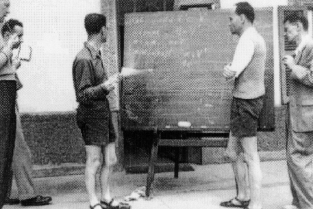
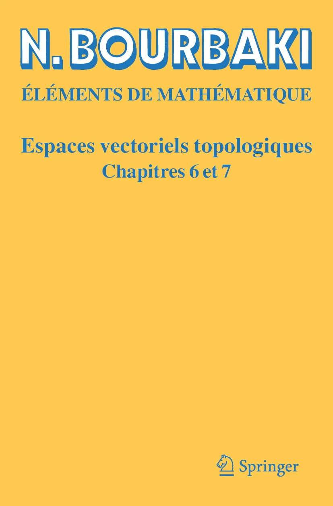

Nicolas Bourbaki est l'un des mathématiciens les plus cités du XXe siècle, et pourtant il n'a jamais existé. Ce nom est le pseudonyme collectif d'un groupe de mathématiciens français qui, à partir de 1935, a entrepris de réécrire les fondements des mathématiques dans un langage unifié, rigoureux et abstrait. Son œuvre principale, les *Éléments de mathématique*, compte une quarantaine de volumes et plusieurs dizaines de milliers de pages. Ces ouvrages, reconnaissables à leur couverture jaune, ont longtemps occupé une place de référence dans les bibliothèques universitaires.

Cet article s'appuie sur une série de six vidéos consacrées à Bourbaki, qui mêlent récit historique, extraits d'archives et témoignages de mathématiciennes et de mathématiciens. Elles sont intégrées en fin d'article. Ces vidéos sont proposées par la [plateforme *Savoirs* de l'Ecole Normale Supérieure](https://savoirs.ens.fr/){target=_blank}.

## Une génération sans maîtres

L'histoire commence à l'École normale supérieure (ENS), à Paris. Les cinq jeunes hommes à l'origine du groupe y sont entrés entre 1922 et 1926 :

* André Weil, élève très précoce, entré à 16 ans, également latiniste, helléniste et sanskritiste ;
* Jean Delsarte, premier ami de Weil à l'ENS, qui rédigera les comptes rendus des réunions ;
* Henri Cartan, héritier d'une famille de mathématiciens ;
* Jean Dieudonné, connu pour ses colères ;
* Claude Chevalley, le plus jeune du groupe.

Ces élèves appartiennent à ce que les vidéos appellent une « génération sans maîtres » : beaucoup de ceux qui auraient dû les instruire sont morts pendant la Première Guerre mondiale. Les professeurs en place ignorent en partie les bouleversements en cours, notamment en Allemagne, où l'algèbre et les fondements de la discipline sont profondément renouvelés, en particulier à Göttingen.

Après des séjours outre-Rhin, les cinq amis sont nommés dans différentes universités françaises. Ils constatent que les manuels utilisés à l'époque où ils étaient étudiants sont toujours en usage, alors qu'ils doivent désormais enseigner. Ils se retrouvent au café Capoulade, à Paris, et décident d'écrire un nouveau manuel. Ce projet, d'abord conçu comme un cours de licence, devient une entreprise bien plus vaste : la réécriture d'une grande partie des mathématiques de l'époque.

## Canular à l'Académie des sciences

Pour signer l'ouvrage, le groupe invente un auteur. Une biographie fictive lui est même fabriquée : un prénom, une date de naissance, une origine. Bourbaki serait un ancien professeur de l'université royale de **Poldévie**, pays inexistant.

Le 23 décembre 1935, le canular franchit un cap. Henri Cartan obtient de son père, le mathématicien et académicien Élie Cartan, qu'il présente à l'Académie des sciences une note signée de Bourbaki. La lettre d'accompagnement décrit un ancien professeur ruiné, qui donne désormais des leçons de belote dans un café de Clichy et ne s'occupe plus de mathématiques. Elle précise néanmoins qu'il a accepté de publier un résultat utile à la théorie moderne de l'intégration. L'Académie publie la note : Bourbaki entre ainsi dans l'histoire officielle des mathématiques.

## Travail collectif et anonymat

Le groupe se réunit en congrès, trois fois par an, pendant une à deux semaines, dans des lieux isolés. Le premier a lieu en 1935 à Besse-en-Chandesse, en Auvergne. Le fonctionnement est resté le même au fil des décennies :

* les rédactions sont préparées avant le congrès et distribuées à tous les membres ;
* elles sont lues à haute voix et discutées en séance, parfois pendant des heures sur une seule page ;
* il n'y a pas de chef, même si certaines voix sont plus fortes que d'autres ;
* les comptes rendus conservent l'ambiance des débats, avec humour, par exemple à propos des démissions répétées (et jamais définitives) de Jean Dieudonné.

Lors du premier congrès, le groupe estime l'ampleur de l'ensemble à 2 500 à 3 000 pages. Les *Éléments de mathématique* en compteront finalement beaucoup plus.

Les membres adoptent aussi une règle fondatrice : **l'anonymat**. Personne ne revendique l'écriture du traité. Selon les mathématiciens interrogés, cette règle évite que l'ouvrage devienne une ligne de plus sur un curriculum vitae et permet de mettre de côté les egos pour produire un texte clair, compréhensible et utilisable par tous.

## La guerre et la parution du premier tome

La dispersion des membres pendant la guerre n'interrompt pas le projet. Selon le récit des vidéos, André Weil, en séjour de recherche à Helsinki, est arrêté par la police finlandaise, qui trouve chez lui des manuscrits en « poldève » et un faire-part de mariage fictif de la fille de Bourbaki. Soupçonné d'espionnage, il est condamné à mort et doit sa grâce à l'intervention d'un collègue mathématicien finlandais.

En 1940 paraît malgré tout le premier tome des *Éléments de mathématique*. Dans leur correspondance, une formule revient comme un leitmotiv : « Bourbaki pas mort ».

## Les *Éléments de mathématique*

Après la guerre, le projet se développe dans un contexte intellectuel favorable : c'est l'âge d'or du structuralisme, qui cherche, dans de nombreuses disciplines, des structures profondes derrière la diversité des phénomènes. Bourbaki en est l'incarnation mathématique la plus radicale.

L'objectif du groupe n'est pas tant de démontrer de nouveaux théorèmes que de refonder les bases, de cartographier les mathématiques et de leur donner une langue commune. Cette langue est fournie par la **théorie des ensembles**.

::: {.callout-tip}
## Les ensembles, « atomes » des mathématiques

Un intervenant compare le rôle des ensembles au début du XXe siècle à celui des atomes en physique : tous les objets mathématiques peuvent être décrits comme des ensembles. Cela en fait un langage commun et, pour reprendre ses mots, un fondement qu'on a espéré universel.
:::

Ce traité a une ambition inédite par l'étendue des domaines couverts, et il se veut précis et complet. Il est souvent décrit comme une sorte de mode d'emploi encyclopédique des mathématiques.

Le style est particulier : une écriture sèche, sans motivation ni enjolivement, mais très soignée. Un intervenant évoque la beauté du diamant. Cette façon d'écrire a, selon un autre témoin, durablement changé la manière dont on rédige les mathématiques au XXe siècle : définitions, énoncés et démonstrations s'enchaînent de façon très structurée, sans commentaire superflu.

## L'apogée et la règle des 50 ans

Dans les années 1960, Bourbaki est au sommet de son influence. Le séminaire Bourbaki, organisé trois jours par mois devant une salle comble, est la vitrine des mathématiques du moment : on y présente les résultats marquants, et y assister revient à prendre le pouls de la discipline.

Pour rester à l'avant-garde, le groupe se renouvelle selon une règle précise : **les membres doivent partir à 50 ans**. Les recrues potentielles, appelées « cobayes », sont observées et testées avant d'être admises. Plusieurs nouveaux membres obtiendront ensuite la médaille Fields. Les mathématiciens interrogés nuancent toutefois l'idée que la créativité serait réservée aux plus jeunes : l'expérience apporte aussi une meilleure compréhension de nombreux domaines.

## Critiques et « mort » de Bourbaki

À la fin des années 1960, les critiques se multiplient :

* une puissance institutionnelle jugée excessive ;
* un mépris affiché pour les mathématiques appliquées ;
* une organisation opaque ;
* des séminaires considérés comme de plus en plus difficiles à suivre.

Le groupe est aussi traversé par les événements de 1968 : certains anciens membres s'engagent aux côtés des étudiants, d'autres estiment que la politique n'est pas leur domaine.

Les vidéos soulignent un autre point : à la fin des années 1960, le groupe ne compte aucune femme. La mathématicienne Michèle Vergne témoigne de son expérience du séminaire Bourbaki en 1969 et rapporte des remarques désobligeantes sur son exposé. Des étudiantes interrogées aujourd'hui évoquent la faible proportion de filles dans les cursus de mathématiques fondamentales, sans que le sujet soit propre à Bourbaki.

Le 11 novembre 1968, le groupe fait paraître un faire-part de décès parodique annonçant la mort de Nicolas Bourbaki, truffé de références mathématiques (le « compactifié d'Alexandrov de l'univers », par exemple). Le groupe, lui, a poursuivi son activité.

## Bourbaki aujourd'hui
 
Contrairement à ce que laisse entendre le faire-part de 1968, Bourbaki existe toujours, sous la forme de l'[Association des collaborateurs et collaboratrices de Nicolas Bourbaki](https://www.bourbaki.fr/){target="_blank"}, créée en 1952. Son activité la plus visible est le **séminaire Bourbaki**, organisé à l'Institut Henri Poincaré, à Paris, depuis 1948 et en général quatre fois par an. À chaque séance, des mathématiciens reconnus présentent les travaux d'autres chercheurs, sur des sujets choisis par les membres de l'association. Une version du vendredi, plus accessible aux non-spécialistes, complète le programme, et les exposés sont enregistrés et mis en ligne.
 
La publication des *Éléments de mathématique* se poursuit également : le site annonce pour 2026 un nouveau volume, consacré aux espaces vectoriels topologiques (chapitres 6 et 7). L'identité des membres, en revanche, reste secrète.

## Les six vidéos

**1. Présentation**

<iframe width="560" height="315" src="https://www.youtube.com/embed/zhKLvz4xc0s" title="YouTube video player" frameborder="0" allow="accelerometer; autoplay; clipboard-write; encrypted-media; gyroscope; picture-in-picture; web-share" referrerpolicy="strict-origin-when-cross-origin" allowfullscreen></iframe>

**2. Les origines à l'ENS**

<iframe width="560" height="315" src="https://www.youtube.com/embed/x-lkmyk9WNs" title="YouTube video player" frameborder="0" allow="accelerometer; autoplay; clipboard-write; encrypted-media; gyroscope; picture-in-picture; web-share" referrerpolicy="strict-origin-when-cross-origin" allowfullscreen></iframe>

**3. Le canular et le travail collectif**

<iframe width="560" height="315" src="https://www.youtube.com/embed/fJTr742pFzk" title="YouTube video player" frameborder="0" allow="accelerometer; autoplay; clipboard-write; encrypted-media; gyroscope; picture-in-picture; web-share" referrerpolicy="strict-origin-when-cross-origin" allowfullscreen></iframe>

**4. La guerre, le structuralisme et le traité**

<iframe width="560" height="315" src="https://www.youtube.com/embed/QeqIcZbtmfY" title="YouTube video player" frameborder="0" allow="accelerometer; autoplay; clipboard-write; encrypted-media; gyroscope; picture-in-picture; web-share" referrerpolicy="strict-origin-when-cross-origin" allowfullscreen></iframe>

**5. L'apogée, les critiques et la fin du mythe**

<iframe width="560" height="315" src="https://www.youtube.com/embed/CYxH_1sdGmU" title="YouTube video player" frameborder="0" allow="accelerometer; autoplay; clipboard-write; encrypted-media; gyroscope; picture-in-picture; web-share" referrerpolicy="strict-origin-when-cross-origin" allowfullscreen></iframe>

**6. Bourbaki aujourd'hui**

<iframe width="560" height="315" src="https://www.youtube.com/watch?v=_cZmiBDHA7U" title="YouTube video player" frameborder="0" allow="accelerometer; autoplay; clipboard-write; encrypted-media; gyroscope; picture-in-picture; web-share" referrerpolicy="strict-origin-when-cross-origin" allowfullscreen></iframe>
